# Does INT8 make Leela stronger per second?

BT3 post-training quantization in lc0: neural outputs, search repair and measured systems tradeoffs

Ritwik Mishra (ME23B237) and Anjan R D (ME23B157)  
CS6886 - Systems for Deep Learning, IIT Madras

## Abstract

We evaluate a frozen BT3 chess transformer in lc0 through TensorRT, comparing a wrapped FP16 baseline with a cumulative signed W8A8 post-training ladder, two pruning variants and policy/value swaps. The selected SmoothQuant model s4 achieves 6706/6720 raw outcome-preserving moves, versus 6706/6720 for FP16 on the common expanded test cohort. Historical comparable repeated measurements show 40.81% higher median search throughput and 27.88% lower batch 64 network latency for s4. Fixed-node, baseline-conditioned challenge, fixed-time and full-game results are reported separately. The two match settings contain 500 games each (100 ms: s4 has more wins; 200 ms: s4 has more wins). These observations test separate links from compression to inference speed, visits per second and decisions; a faster network alone cannot establish improved playing strength. Adverse sparse results and limits of energy/precision evidence remain part of the answer.

## 1. Motivation and research questions

Leela combines a neural evaluator with Monte Carlo tree search (MCTS). Quantization can change both the policy that guides exploration and the values backed up through the tree. Faster evaluation might buy more search within a fixed time, but search might correct, hide or amplify the resulting errors. We therefore ask three separate questions: RQ1, how does compression change neural outputs and selected moves? RQ2, what does a fixed amount of search repair, and do policy/value swaps distinguish sensitivity? RQ3, do measured speed gains translate to more visits, better timed decisions or more game wins?

Haque, Wei and Mueller [1] motivate separating raw Lc0 decisions from search with exact endgame labels. Their older network and corpus do not predict BT3 INT8 outcomes. SmoothQuant [2] and SparseGPT [3] motivate rescaling and compensated pruning; their language-model results do not guarantee chess improvements. GPTQ [4] is related background, not the quantizer used here. Sparse execution [5], roofline analysis [6] and NNUE [7] provide systems context with different computation and evaluation boundaries.

## 2. BT3, runtime and compression

The supplied BT3-768x15x24h-swa-2790000 checkpoint uses INPUT_CLASSICAL_112_PLANE, with input shape [batch,112,8,8]. Outputs are an 1858-entry policy, a three-component win/draw/loss (WDL) head, and moves-left. Policy supplies legal-move priors; WDL supplies a neural position evaluation; moves-left is auxiliary. The final move comes from search statistics. A selected move's tablebase accuracy is not its neural WDL probability.

The checkpoint is exported with lc0 leela2onnx. A metadata-preserving wrapper embeds the ONNX graph in an lc0 network. FP16 means the exported graph through onnx-trt optimize=6, permitting FP16. Quantized variants use optimize=8, permitting INT8 plus floating exceptions. Python ONNX Runtime1.31.1 performs CPU preparation; lc0 v0.33.0-rc0 bundles GPU ORT1.22.1 and TensorRT10.12. The benchmark device is an RTX4060 Laptop8 GB on Windows with 32 GB host memory. Flags express permissions; actual kernels/layer inspection establish bounded execution evidence.

| Model | Added method |
|---|---|
| fp16 | Wrapped exported floating graph; runtime FP16 permission |
| s1 | Signed symmetric per-tensor W8A8; minmax calibration |
| s2 | Per-channel weight scales |
| s3 | Percentile99.999 calibration |
| s4 | SmoothQuant alpha 0.7; frozen main INT8 |
| s4aa | s4 plus dynamic attention products |
| s0 | Magnitude 2:4 pruning then best-recipe quantization |
| s1sp | Sequential SparseGPT 2:4 then best-recipe quantization |
| swap_pol8 / swap_val8 | Policy/value from different complete bodies; quality only |

Calibration stays 512 inputs:256 random-game/history and 256 tablebase inputs. Development selection uses the original 3360 roots and freezes s4 before expanded tests. The ladder uses the adopted custom ORT-based calibration implementation, not ModelOpt. No new calibration, training or test-driven retuning occurs. SmoothQuant implements XW=(X/s)(sW) using explicit compensating Mul branches because a shared LayerNorm output also feeds residual consumers. SparseGPT uses sequential calibration compensation before quantization. Sparse masks alone do not prove sparse GPU execution.

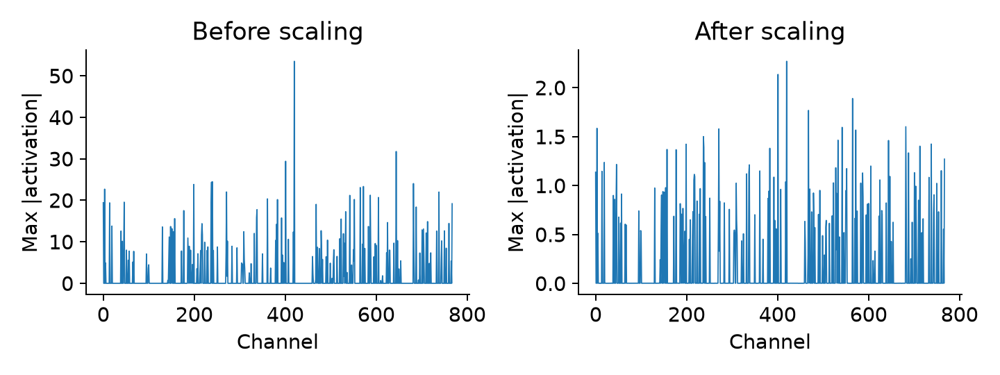

The matched final-model diagnostic checks 768 channels at one layer using all 512 calibration inputs and agrees with compensated scaling. It is a calibration illustration, not GPU precision or test accuracy. The build records 100/101 groups with a lower peak/median activation ratio after rescaling, retaining non-improving groups. These build summaries must not be confused with the plotted single-layer diagnostic.

## 3. Data, scorer and frozen protocol

The original 11200 positions are synthetic legal, nonterminal, decision-sensitive3-5-piece boards, then labelled by local Syzygy tables; they were not downloaded from tablebase files or sampled from human games. The original calibration/development/test pools contain 1120/3360/6720 roots. M includes all 6720 test roots,240 per 28 classes. The prior 2437-root cohort was a time-budgeted class-round-robin FEN-prefix sample, not an unbiased general-chess sample. A 6715-root sensitivity view excludes IDs 388,611,627,965,1100 without reinference or deletion from M.

N contains 24000 fresh five-piece roots,2000 per 12 classes, seed 20261030, IDs 11200-35199. Exact/legal-symmetry overlap is rejected against all 11200 old roots and within N. The legal relation uses pawn-preserving file reflection, pawnless D8 and color/rank mirroring, with transformed tablebase-category checks. The accepted IDs and seeded order are frozen before inference. N is evaluation-only. HM/HN apply the frozen FP16 rule: a wrong raw selected move OR printed preserving policy mass below 0.8. Their observed sizes are 99/632; no size or significance target changes them. N's24000 screening denominator is distinct from the HN paired denominator. Challenges are baseline-conditioned.

FP16 selects a preserving move on 23923/24000 full-N screening roots (77 errors). The fresh application of the challenge rule selects 632 roots; the evaluated frozen HN retains 632. Other models were not evaluated on all N.

The scorer maps Syzygy+2 to win,-2 to loss, and 0/+1/-1 to draw. A correct selected move preserves the root category; DTZ optimality is secondary. Root halfmove clocks remain zero with the adopted FEN-only history. Losing and all-moves-correct roots were excluded by construction. Tablebases supply labels and match adjudication only; evaluated engines never receive SyzygyPath.

| Study | Models / cohorts | Frozen settings |
|---|---|---|
| Raw | A 10 on M/HN; FP16 screens N | go nodes 1; PolicyTemperature 1 |
| Main nodes | B9 on M; s0 supplement | 100/400/800/1600; s0 only 100/400 |
| Challenge | B9 on HM/HN | 10/25/50/100/200; s0 HN100/400 |
| Timed | fp16/s4 on M/HN | 100/200/400/800 ms; minibatch 256, overhead 20 ms |
| Games | fp16/s4,250 paired openings | 500 games each at 100/200 ms; minibatch 64, overhead 20 ms |

Fixed-node search uses Threads1, MinibatchSize 256 and SmartPruningFactor 0. Timed search retains default threads/pruning. Actual nodes can overshoot and timed searches can stop early. Reset/cache conventions are retained; each bounded block records its fresh engine and timed excluded warm-up. Compatible old observations retain source/model/settings provenance, while missing conditions are measured. Distinct compatible keys are stored once and are not independent repeats in multiple views.

Matches use 250 distinct six-ply balanced openings sampled with seed 20261030 from the attributed jhorthos/Caissabase-derived book [8], with colors swapped and the same openings at both budgets. Both resident engines are warmed; one search runs at a time, Ponder=false. Two disjoint excluded pilot openings check shared timing limits. The imported legal-game/tablebase/resignation/draw rules and 400-ply cap apply. Ordinary soft overruns are retained as timings, not clock forfeits. Complete-game atomic records support exact-contract resumption.

We report paired correct/n, discordances and accuracy differences. Primary contrasts are FP16/s4; others are secondary. McNemar p-values are exact nominal values, with Holm adjustment within study/cohort contrast families when interpreted inferentially. Confidence intervals use 10000 fixed-seed material-stratified paired resamples over legal symmetry groups. Shared roots/budgets are not independent observations; a degenerate interval does not prove equivalence. Printed-prior KL is approximate, and printed V deviation is not full WDL-vector error. All conditions are retained irrespective of outcome.

## 4. RQ1: neural outputs and raw move quality

| Model | Correct/n | Accuracy % | Approx. KL | Top1 % | Mean abs dV |
|---|---|---|---|---|---|
| fp16 | 6706/6720 | 99.7917 | 0.00000 | 100.00 | 0.00000 |
| s1 | 6692/6720 | 99.5833 | 0.03042 | 82.25 | 0.01425 |
| s2 | 6693/6720 | 99.5982 | 0.02835 | 81.89 | 0.01316 |
| s3 | 6697/6720 | 99.6577 | 0.02289 | 83.74 | 0.01473 |
| s4 | 6706/6720 | 99.7917 | 0.00436 | 89.87 | 0.00481 |
| s4aa | 6703/6720 | 99.7470 | 0.00518 | 87.98 | 0.00495 |
| s0 | 5381/6720 | 80.0744 | 0.75316 | 44.88 | 1.42381 |
| s1sp | 6662/6720 | 99.1369 | 0.07462 | 79.85 | 0.03214 |
| swap_pol8 | 6706/6720 | 99.7917 | 0.00436 | 89.87 | 0.00014 |
| swap_val8 | 6706/6720 | 99.7917 | 0.00001 | 98.24 | 0.00481 |

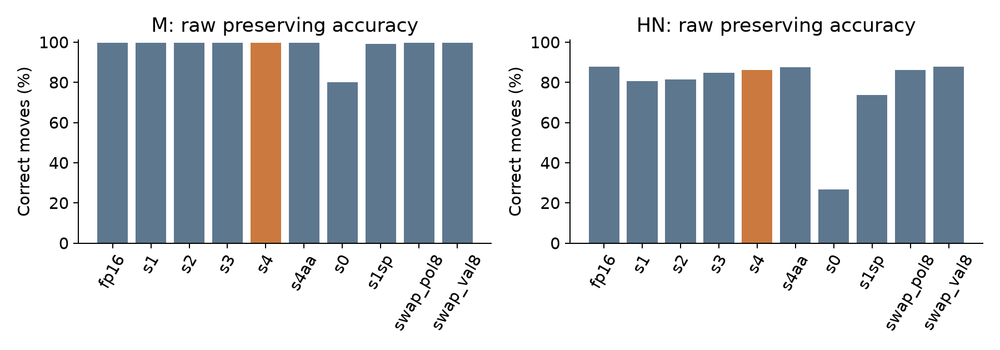

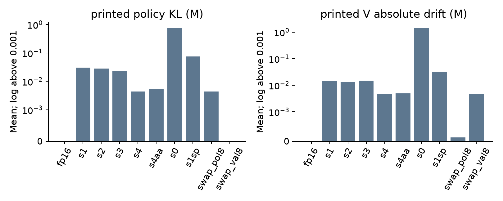

Equal correct counts do not imply equal moves or probabilities. On M, s4 and FP16 preserve 6706/6720 and 6706/6720 outcomes, with 2 s4 improvements and 2 regressions. Approximate mean policy KL is 0.02289 for s3 and 0.00436 for s4; mean printed V drift is 0.01473 and 0.00481. On HN, FP16 preserves 555/632 and s4 545/632, with 11 improvements and 21 regressions. Conditioning HN on FP16 is essential to interpreting that comparison.

The machine-readable graded table contains paired uncertainty for KL, printed-prior top1 agreement, V drift and DTZ optimality, and the adjacent-ladder table retains changes between cumulative steps. The sparse and pruned models' quality results remain part of the evaluation irrespective of outcome.

## 5. RQ2: search repair, challenges and swaps

| Cohort | Nodes | Model | Correct/n | Delta pp | 95% paired interval pp | -worse/+better |
|---|---|---|---|---|---|---|
| M | 100 | fp16 | 6718/6720 | 0.0000 | [0.0000, 0.0000] | -0/+0 |
| M | 100 | s4 | 6718/6720 | 0.0000 | [0.0000, 0.0000] | -0/+0 |
| M | 400 | fp16 | 6720/6720 | 0.0000 | [0.0000, 0.0000] | -0/+0 |
| M | 400 | s4 | 6720/6720 | 0.0000 | [0.0000, 0.0000] | -0/+0 |
| M | 800 | fp16 | 6720/6720 | 0.0000 | [0.0000, 0.0000] | -0/+0 |
| M | 800 | s4 | 6720/6720 | 0.0000 | [0.0000, 0.0000] | -0/+0 |
| M | 1600 | fp16 | 6720/6720 | 0.0000 | [0.0000, 0.0000] | -0/+0 |
| M | 1600 | s4 | 6720/6720 | 0.0000 | [0.0000, 0.0000] | -0/+0 |
| HM | 10 | fp16 | 96/99 | 0.0000 | [0.0000, 0.0000] | -0/+0 |
| HM | 10 | s4 | 94/99 | -2.0202 | [-5.0505, 0.0000] | -2/+0 |
| HM | 25 | fp16 | 96/99 | 0.0000 | [0.0000, 0.0000] | -0/+0 |
| HM | 25 | s4 | 95/99 | -1.0101 | [-4.0404, 2.0202] | -2/+1 |
| HM | 50 | fp16 | 97/99 | 0.0000 | [0.0000, 0.0000] | -0/+0 |
| HM | 50 | s4 | 97/99 | 0.0000 | [0.0000, 0.0000] | -0/+0 |
| HM | 100 | fp16 | 97/99 | 0.0000 | [0.0000, 0.0000] | -0/+0 |
| HM | 100 | s4 | 97/99 | 0.0000 | [0.0000, 0.0000] | -0/+0 |
| HM | 200 | fp16 | 99/99 | 0.0000 | [0.0000, 0.0000] | -0/+0 |
| HM | 200 | s4 | 97/99 | -2.0202 | [-5.0505, 0.0000] | -2/+0 |
| HN | 10 | fp16 | 603/632 | 0.0000 | [0.0000, 0.0000] | -0/+0 |
| HN | 10 | s4 | 595/632 | -1.2658 | [-2.3734, -0.3165] | -10/+2 |
| HN | 25 | fp16 | 614/632 | 0.0000 | [0.0000, 0.0000] | -0/+0 |
| HN | 25 | s4 | 610/632 | -0.6329 | [-1.4241, 0.0000] | -5/+1 |
| HN | 50 | fp16 | 622/632 | 0.0000 | [0.0000, 0.0000] | -0/+0 |
| HN | 50 | s4 | 620/632 | -0.3165 | [-1.2658, 0.6329] | -6/+4 |
| HN | 100 | fp16 | 629/632 | 0.0000 | [0.0000, 0.0000] | -0/+0 |
| HN | 100 | s4 | 625/632 | -0.6329 | [-1.2658, -0.1582] | -4/+0 |
| HN | 200 | fp16 | 628/632 | 0.0000 | [0.0000, 0.0000] | -0/+0 |
| HN | 200 | s4 | 626/632 | -0.3165 | [-0.7911, 0.0000] | -2/+0 |

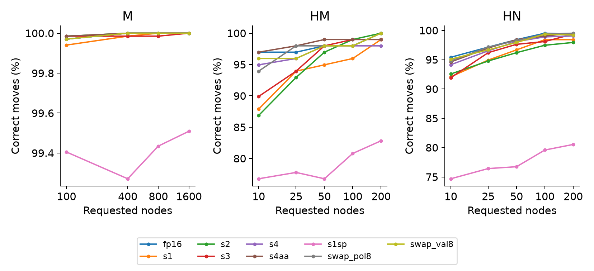

The main and low-node comparisons use the same roots at each compared condition. The historical 43-root hard view remains recoverable. Challenge conditioning and a small number of discordances limit generalization even when an observed difference is nonzero. Search need not improve monotonically at every finite budget. No p-value, minimum HN count or INT8 gain was required to complete collection.

Main-pair M counts (FP16/s4) are 100 nodes: 6718/6718, 400 nodes: 6720/6720, 800 nodes: 6720/6720, 1600 nodes: 6720/6720. HN endpoint counts (FP16/s4) are 10 nodes: 603/595, 200 nodes: 628/626. Search repairs many raw errors, but the paired tables retain every compression regression.

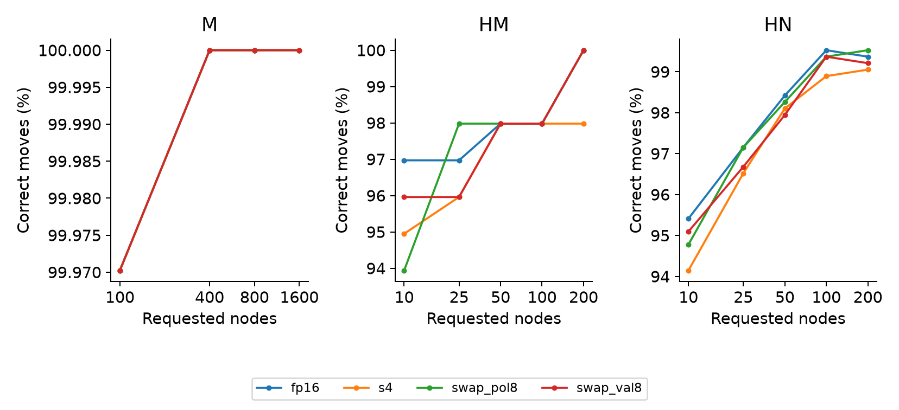

Swaps route policy and value/moves-left between s4 and the floating-side graph. They are not timed frontier points, and backend numerical changes can prevent a perfectly isolated intervention on one scalar. Saturated or tied swap outcomes cannot establish equal policy/value importance. Magnitude retains only its predeclared 100/400-node supplement; no missing high-budget curve is invented.

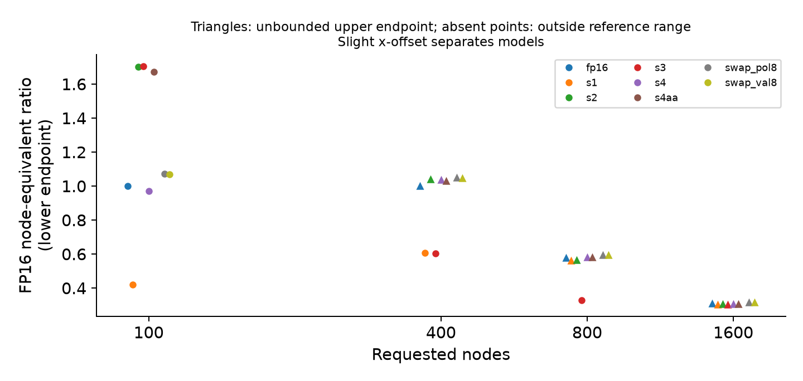

The FP16 reference uses its observed monotone envelope in log actual nodes. A flat accuracy curve admits an interval of inverse node counts; the figure/table preserve that uncertainty instead of fabricating a precise efficiency ratio.

## 6. RQ3: fixed time and complete games

| Cohort | ms | Model | Correct/n | Visits (mean) | Wall ms (mean) |
|---|---|---|---|---|---|
| M | 100 | fp16 | 6718/6720 | 1400.8 | 94.89 |
| M | 100 | s4 | 6718/6720 | 1488.3 | 94.75 |
| M | 200 | fp16 | 6719/6720 | 3800.0 | 184.16 |
| M | 200 | s4 | 6720/6720 | 4109.9 | 184.21 |
| M | 400 | fp16 | 6720/6720 | 7155.5 | 313.22 |
| M | 400 | s4 | 6720/6720 | 7763.6 | 308.60 |
| M | 800 | fp16 | 6720/6720 | 14576.6 | 601.20 |
| M | 800 | s4 | 6720/6720 | 16975.2 | 589.90 |
| HN | 100 | fp16 | 621/632 | 166.5 | 86.06 |
| HN | 100 | s4 | 620/632 | 212.6 | 86.14 |
| HN | 200 | fp16 | 628/632 | 732.2 | 185.14 |
| HN | 200 | s4 | 627/632 | 1005.7 | 185.24 |
| HN | 400 | fp16 | 631/632 | 1033.6 | 242.66 |
| HN | 400 | s4 | 631/632 | 1387.2 | 234.94 |
| HN | 800 | fp16 | 630/632 | 2428.0 | 445.20 |
| HN | 800 | s4 | 631/632 | 3255.5 | 431.33 |

| Cohort | ms | s4 delta pp | 95% paired interval pp | -worse/+better | Holm p |
|---|---|---|---|---|---|
| M | 100 | 0.0000 | [0.0000, 0.0000] | -0/+0 | 1.0000 |
| M | 200 | 0.0149 | [0.0000, 0.0446] | -0/+1 | 1.0000 |
| M | 400 | 0.0000 | [0.0000, 0.0000] | -0/+0 | 1.0000 |
| M | 800 | 0.0000 | [0.0000, 0.0000] | -0/+0 | 1.0000 |
| HN | 100 | -0.1582 | [-0.9494, 0.6329] | -4/+3 | 1.0000 |
| HN | 200 | -0.1582 | [-0.6329, 0.3165] | -2/+1 | 1.0000 |
| HN | 400 | 0.0000 | [0.0000, 0.0000] | -0/+0 | 1.0000 |
| HN | 800 | 0.1582 | [0.0000, 0.4747] | -0/+1 | 1.0000 |

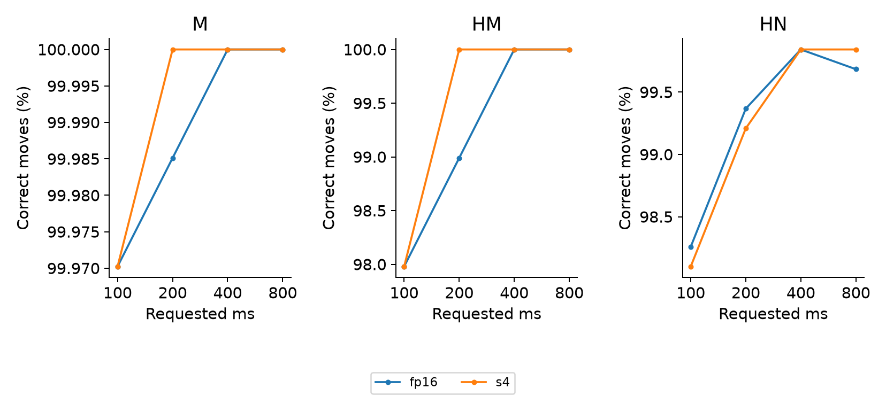

Requested time, actual wall/engine time and visits are distinct. Early stopping and skewed visit distributions can make a fixed-time visit ratio differ from a throughput benchmark's ratio. A one-root accuracy difference or more visits alone cannot demonstrate stronger full-game play. HM timed views are derived from M without counting a second observation.

Timed preserving-count changes (s4 minus FP16) on M are 100 ms: +0, 200 ms: +1, 400 ms: +0, 800 ms: +0; on HN they are 100 ms: -1, 200 ms: -1, 400 ms: +0, 800 ms: +1. At 800 ms, mean visits (FP16/s4) are M: 14576.6/16975.2, HN: 2428.0/3255.5. Workload and accuracy changes must be assessed separately.

| ms | Games | FP16 wins | s4 wins | Draws | FP16 score |
|---|---|---|---|---|---|
| 100 | 500 | 50 | 93 | 357 | 0.4570 |
| 200 | 500 | 36 | 39 | 425 | 0.4970 |

At 100 ms, s4 has more wins: an absolute margin of 43 games (8.60 percentage points). FP16/s4 win percentages are 10.00%/18.60%; draws are 71.40%.

At 200 ms, s4 has more wins: an absolute margin of 3 games (0.60 percentage points). FP16/s4 win percentages are 7.20%/7.80%; draws are 85.00%.

The 100 ms setting shows a practical win-count advantage for s4 in this opening set; the 200 ms setting is much closer and has 85% draws. This budget dependence limits a general strength claim and does not isolate throughput from numerical drift as the cause.

Matches are descriptive: counts/percentages, score, explicit win margins, move timing and all termination reasons. There is no required Elo/LOS, significance test, hypothesis acceptance threshold, result-based stopping or resizing. The complete-game and per-move tables preserve what actually ran. Production and an independent evaluator replay are separate observations; different winners or timing need not be a software failure.

## 7. Systems explanation and energy limits

| Model | Trials | Search visits/s | Batch64 NN ms | GPU total mJ/visit |
|---|---|---|---|---|
| fp16 | 5 | 4842 | 18.08 | 17.3372 |
| s1 | 3 | 6946 | 12.20 | 12.1905 |
| s2 | 3 | 7436 | 12.18 | 11.3473 |
| s3 | 3 | 7111 | 12.18 | 11.8464 |
| s4 | 5 | 6818 | 13.04 | 12.7155 |
| s4aa | 3 | 5956 | 14.48 | 13.7130 |
| s0 | 3 | 3775 | 13.07 | 22.2447 |
| s1sp | 3 | 5316 | 12.99 | 15.7775 |

Historical comparable s4 median throughput is 40.81% above FP16 and batch 64 network latency is 27.88% lower. FP16/s4 have five trials each and other single-body variants three each. These are observed repeats with session/thermal context, not automatically independent confidence-interval replicates. AC/Balanced mode and natural clocks are recorded; clock locking was denied. Background activity flags are informational, not assumed equal across trials. U2 numerical/load and bounded systems checks are labelled separately.

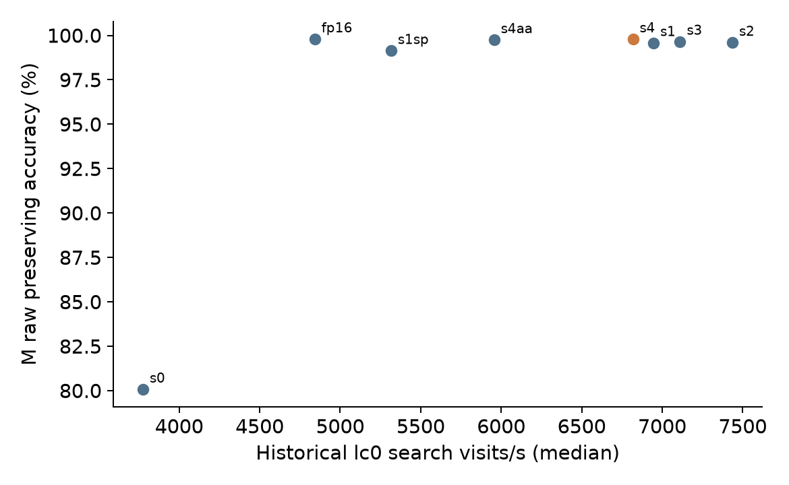

Actual standalone s4 inspector evidence proves 164 INT8 matrix operations, representing 97.8517% of matrix arithmetic among 195 matrix operations (9078490112 arithmetic operations,4539245056 MACs per position). This is not parameter fraction, all-operation precision or runtime share. 30 matrix operations remain unmapped by exact metadata; their precision is unresolved. lc0 traces demonstrate named precision kernels, not whole-operation coverage; standalone TensorRT mappings do not automatically describe lc0's internal ORT engine.

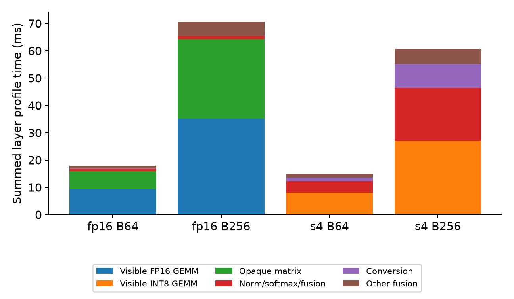

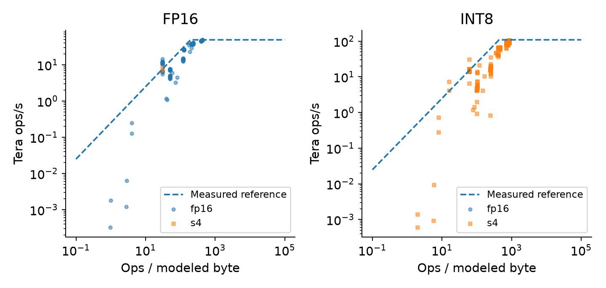

The partial roofline maps 496 simple GEMM points. Empirical reference rates are 48.92 FP16 TFLOP/s, 108.72 INT8 TOP/s and modelled 248.71 GB/s; 39 above-reference observations remain plotted. Shape, fusion, accumulation and clock differences prevent treating those lines as universal hardware ceilings or proof of stationary dataflow.

Standalone selected sparse GEMM tactics number 126 for magnitude and 125 for SparseGPT; the preserved old regex count 0 was an incomplete historical summary. Single-configuration dense/sparse ratios are 1.077x/1.066x at batch 256. lc0 does not enable that standalone sparsity flag, so these results do not establish lc0 sparse acceleration. Pruning can reduce network latency while worsening search throughput and move quality.

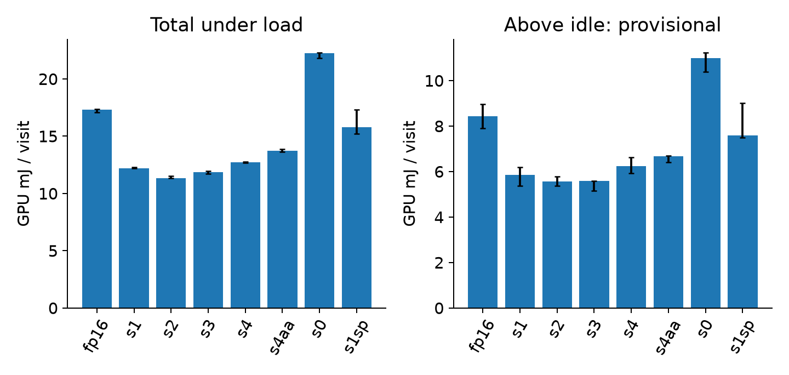

These logs contain 49 implausible inactive-phase power samples across 23/28 trials on a 120 W-cap laptop GPU. The maximum relative difference between under-load counter/sample means is 0.5983%; this is an internal cross-check, not external-meter validation. Total GPU mJ/visit is retained separately. Historical idle baselines lack a trustworthy instantaneous cross-check, so above-idle subtraction remains provisional; a successful fresh idle diagnosis cannot retroactively validate it. No CPU/whole-machine energy or equal-energy accuracy claim is made.

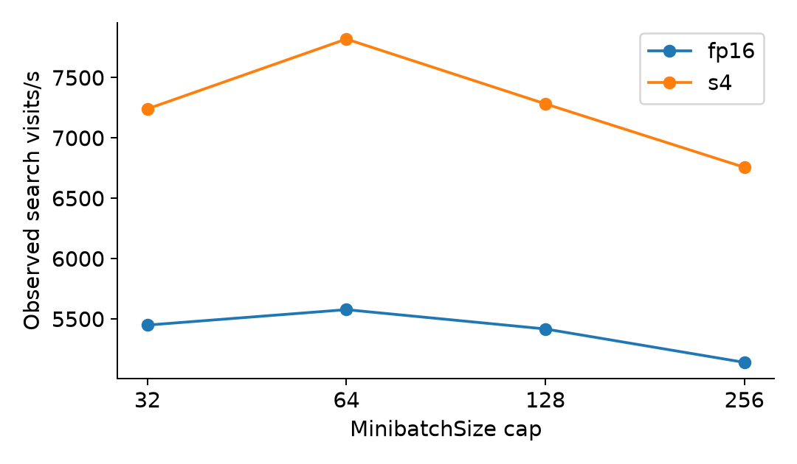

The four-point 32/64/128/256 sweep distinguishes search throughput from full-batch network latency. An observed best cap does not establish global optimality for all positions or short move budgets. Swaps have two bodies and are excluded from speed/energy coordinates.

## 8. Limits, reproducibility and conclusion

This is one network on one laptop, with synthetic decision-sensitive endgames, a ceiling-prone outcome metric, limited printed-output precision and baseline-conditioned challenges. The sensitivity view discloses cross-pool symmetry without redefining M. Development selection is frozen; new results cannot choose a new recipe. Numerical drift, preservation of tablebase categories, actual visits, throughput and playing strength remain separate empirical endpoints. Negative, saturated or inconclusive results are valid outcomes.

The package contains the canonical models, checkpoint/calibration/development inputs, scorer, frozen roots/challenges/openings, per-root/game observations, necessary systems evidence and a public reproduction entry. Model derivation and the frozen development-selection evidence can be replayed separately from canonical-input checksum checks. Fresh searches, matches and performance may vary; deterministic analysis must reproduce exact counts/rounding from identical inputs. Serialized TensorRT caches are hardware-specific and fresh caches are rebuilt where required. The final verification record states the actual evaluator coverage; a subset smoke test cannot count as full reproduction.

The selected INT8 model is faster in the measured runtime and improves some practical game counts, especially at 100 ms. The expanded endgame tests show near-ceiling main accuracy and mixed challenge/timed effects. Thus the evidence supports the compression-to-speed link more strongly than a general speed-to-decision-quality claim. Sparse/pruned variants show that acceleration permissions and zero weights alone do not guarantee better search or decisions.

Full independent evaluator reproduction (U11) and the subsequent integrated release audit (U12) are pending. The supplied primary experiments and report are complete; any bounded backup checks are recorded separately in verification.json. Such checks do not establish full experimental reproducibility.

## References

[1] Haque, R., Wei, T.-H., Mueller, M. On the Road to Perfection? Evaluating Leela Chess Zero Against Endgame Tablebases. ACG2021 proceedings, LNCS 13262,142-152,2022. https://doi.org/10.1007/978-3-031-11488-5_13

[2] Xiao, G. et al. SmoothQuant: Accurate and Efficient Post-Training Quantization for Large Language Models. ICML,2023. https://proceedings.mlr.press/v202/xiao23c.html

[3] Frantar, E., Alistarh, D. SparseGPT: Massive Language Models Can Be Accurately Pruned in One-Shot. ICML,2023. https://proceedings.mlr.press/v202/frantar23a.html

[4] Frantar, E. et al. GPTQ: Accurate Post-Training Quantization for Generative Pre-trained Transformers. ICLR,2023. https://arxiv.org/abs/2210.17323

[5] Mishra, A. et al. Accelerating Sparse Deep Neural Networks.2021. https://arxiv.org/abs/2104.08378

[6] Williams, S., Waterman, A., Patterson, D. Roofline: An Insightful Visual Performance Model for Multicore Architectures. Communications of the ACM,2009. https://doi.org/10.1145/1498765.1498785

[7] Stockfish developers. NNUE documentation. https://official-stockfish.github.io/docs/nnue-pytorch-wiki/docs/nnue.html

[8] Thomas, J. H. Opening books derived from Caissabase; balanced six-ply Q0-0.25 tier. https://github.com/jhorthos/lczero-training/wiki/Opening-Books

Software: Leela Chess Zero, TensorRT10.12, ONNX Runtime (distinct CPU/GPU versions), python-chess/Syzygy; exact identities, licenses and sources are supplied in the package.
